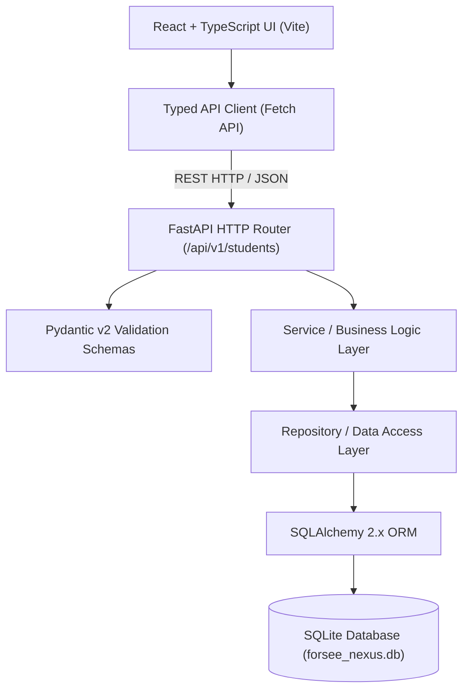
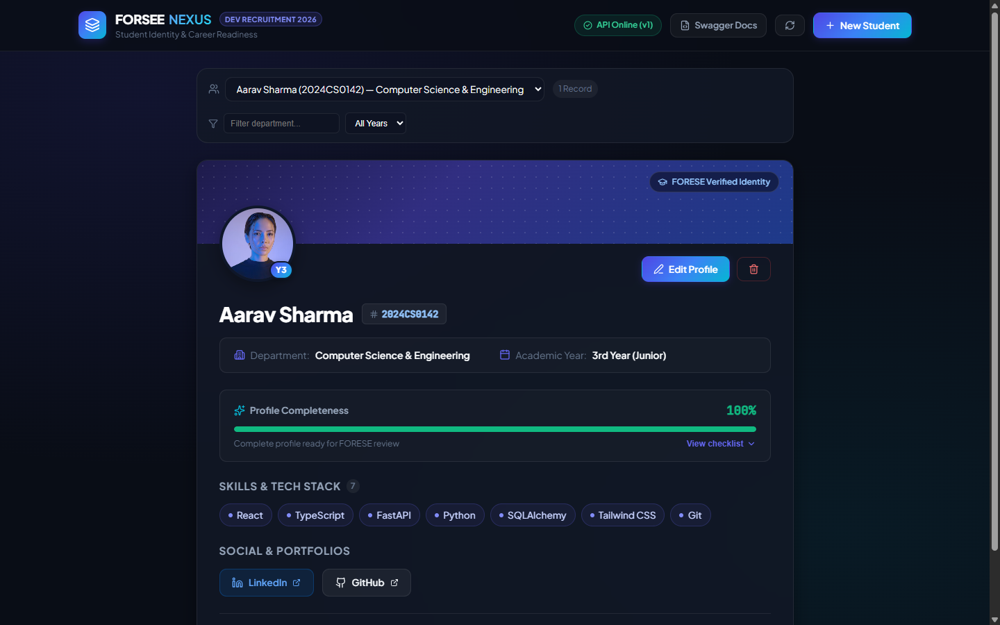
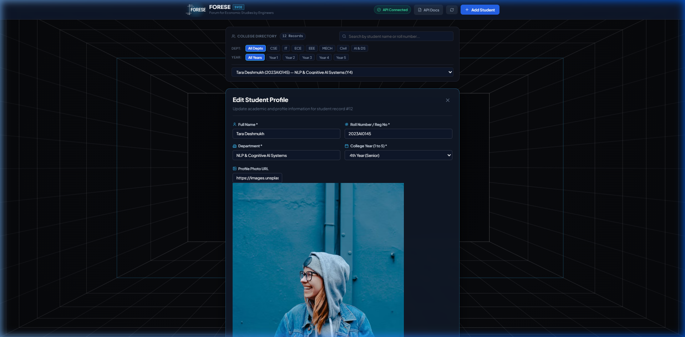
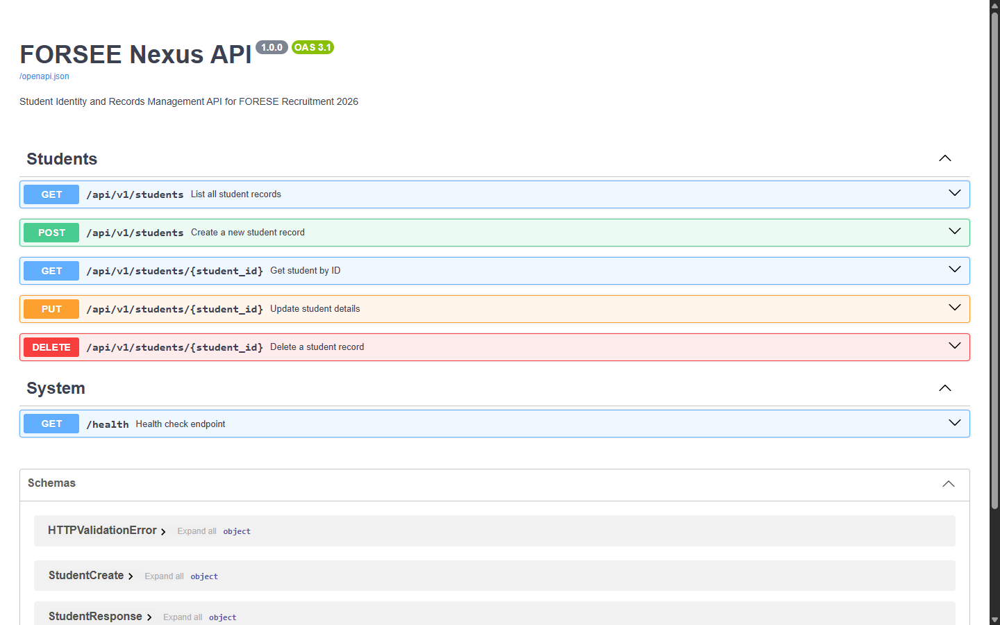
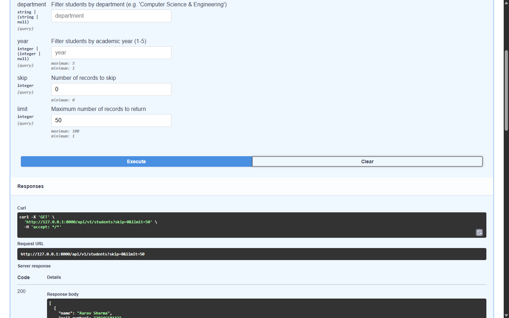
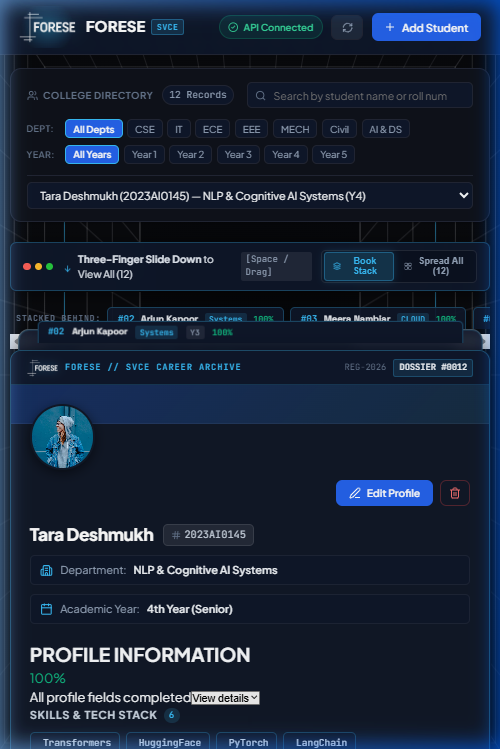

# FORSEE Nexus

> **Official FORESE Development Team Recruitment 2026 Submission**  
> A high-performance, layered student identity and profile management platform designed as the digital foundation for FORESE's student development, mock placement, and career-readiness workflows.

---

## Table of Contents
- [Problem Statement](#problem)
- [Key Features](#features)
- [System Architecture](#architecture)
- [Technology Stack](#tech-stack)
- [Project Structure](#project-structure)
- [Local Setup (Windows)](#setup)
- [Running Backend](#running-backend)
- [Running Frontend](#running-frontend)
- [Automated Testing & Code Quality](#testing)
- [API Contract & Endpoints](#api-endpoints)
- [Screenshots](#screenshots)
- [Engineering Decisions](#engineering-decisions)
- [Future Scope](#future-scope)

---

## Problem

Student organisations and placement readiness cells like **FORESE** require dependable, standardized student identity records to facilitate mock interviews, aptitude evaluations, placement tracking, and skill profiling. Existing student records often suffer from:
1. **Scattered or Unstructured Data**: Fragmented records lacking structured verification of technical skills and professional profiles (GitHub, LinkedIn).
2. **Weak Academic Record Integrity**: Poor validation of unique roll numbers, department associations, and progression years.
3. **Rigid Interfaces**: Lack of responsive, accessible user experiences that allow students and administrators to inspect completeness and update credentials smoothly.

**FORSEE Nexus** addresses this by providing a resilient, layered REST API paired with a responsive profile interface featuring transparent completeness analytics and real-time validation.

---

## Features

### Backend (Student Records API)
- **Full RESTful Lifecycle**: Complete CRUD support (`GET`, `POST`, `PUT`, `DELETE`) for student profiles.
- **Academic & Profile Data Model**: Manages student name, unique roll number, academic department, college year, avatar URL, skills list, LinkedIn, and GitHub links.
- **Strict Data Validation**: Pydantic v2 schemas validating non-empty trimmed inputs, sanitized alphanumeric roll numbers, bounded college years (1–5), and secure URL schemes.
- **Conflict & Error Handling**: Domain-specific error mapping returning HTTP 409 for duplicate roll numbers, HTTP 404 for nonexistent resources, HTTP 422 for malformed requests, and sanitized HTTP 500 without leaking stack traces.
- **Query Filtering & Pagination**: Filter students dynamically by `department` and `year`, with `skip` and `limit` pagination.
- **Persistence & Seeding**: SQLite persistent storage with automatic table migration and demo profile seeding on startup.
- **Interactive Documentation**: Auto-generated OpenAPI 3.1 Swagger UI (`/docs`) and ReDoc (`/redoc`).

### Frontend (Student Profile Card)
- **View Mode**: Displays avatar with fallback initials, student name, roll number badge, department, academic year, interactive skill badges, and direct links to LinkedIn and GitHub.
- **Edit Mode**: Comprehensive editing with real-time field validation, live avatar image preview, and interactive skills manager (add via Enter/button, remove via badge chip, or quick-select suggestions).
- **Profile Completeness Indicator**: Calculates profile completeness percentage based on meaningful profile fields with an expandable breakdown drawer.
- **Student Management Toolbar**: Switch seamlessly between student profiles, filter by department or year, refresh records, and create new student profiles via a modal dialog.
- **Interactive States**: Explicit visual states for loading spinners, saving in progress, success toast banners, field-level validation errors, and network failure fallback.
- **Responsive & Accessible**: Mobile-first design verified across viewports (375px mobile, 768px tablet, 1440px desktop) with semantic HTML, focus states, and high-contrast color systems.

---

## Architecture

FORSEE Nexus is organized into a clean, layered architecture ensuring clear separation of concerns:



### Architectural Layers
1. **API / Routing Layer (`app/api/`)**: Defines HTTP routes, parses query parameters, and maps responses to HTTP status codes. Contains no direct database queries.
2. **Schema Layer (`app/schemas/`)**: Defines input and output contracts using Pydantic v2, enforcing field transformations, URL sanity, and trimming.
3. **Service Layer (`app/services/`)**: Enforces business rules (duplicate roll number detection, conflict avoidance during updates, existence verification).
4. **Repository Layer (`app/repositories/`)**: Encapsulates SQLAlchemy 2.0 select and mutation queries.
5. **Database Layer (`app/db/` & `app/models/`)**: Manages the SQLAlchemy engine, session lifecycle, and ORM declarations.

---

## Tech Stack

| Domain | Technology | Version | Purpose |
| :--- | :--- | :--- | :--- |
| **Backend Runtime** | Python | 3.12+ | Core programming language |
| **Web Framework** | FastAPI | 0.141+ | Asynchronous REST API framework |
| **Data Validation** | Pydantic | 2.13+ | Schema definitions and runtime validation |
| **Database ORM** | SQLAlchemy | 2.1+ | Relational data persistence and mapping |
| **Database** | SQLite | 3.x | Zero-config local relational storage |
| **Testing** | pytest + httpx | 9.1+ | Isolated in-memory unit and integration tests |
| **Code Quality** | Ruff + Black | Latest | Automated linting and PEP 8 formatting |
| **Frontend Runtime** | Node.js | v24+ | Frontend build runtime |
| **UI Framework** | React | 19.x | Modern component-based view library |
| **Language** | TypeScript | 6.x | Strict type safety across client models |
| **Build Tool** | Vite | 8.x | High-speed frontend development and bundler |
| **Icons** | Lucide React + Inline SVGs | Latest | Clean, accessible iconography |
| **Styling** | Vanilla CSS Tokens | CSS3 | Responsive glassmorphism and modern UI |

---

## Project Structure

```text
forsee-nexus/
├── backend/
│   ├── app/
│   │   ├── api/
│   │   │   └── students.py          # REST endpoints (GET, POST, PUT, DELETE)
│   │   ├── core/
│   │   │   ├── config.py            # Pydantic Settings & CORS configuration
│   │   │   └── exceptions.py        # Domain exceptions & status code handlers
│   │   ├── db/
│   │   │   └── database.py          # SQLAlchemy engine, sessionmaker & Base
│   │   ├── models/
│   │   │   ├── __init__.py
│   │   │   └── student.py           # Student database model definition
│   │   ├── repositories/
│   │   │   └── student.py           # Data access repository layer
│   │   ├── schemas/
│   │   │   ├── __init__.py
│   │   │   └── student.py           # StudentCreate, StudentUpdate, StudentResponse
│   │   ├── services/
│   │   │   └── student.py           # Business logic & validation rules
│   │   └── main.py                  # FastAPI initialization, CORS & lifespan
│   ├── tests/
│   │   ├── conftest.py              # In-memory SQLite fixtures & TestClient
│   │   └── test_students.py         # Full integration & validation test suite
│   ├── .env.example                 # Environment variables template
│   ├── pyproject.toml               # Ruff & Black configuration
│   ├── pytest.ini                   # Backend pytest configuration
│   └── requirements.txt             # Pinned backend dependencies
├── frontend/
│   ├── src/
│   │   ├── components/
│   │   │   ├── BrandIcons.tsx       # LinkedIn & GitHub SVG icons
│   │   │   ├── CompletenessIndicator.tsx # Profile completeness calculation
│   │   │   ├── Navbar.tsx           # Header, API status & action triggers
│   │   │   ├── SkillBadge.tsx       # Reusable skill chip component
│   │   │   ├── SocialLinks.tsx      # Social and portfolio external links
│   │   │   ├── StudentCard.tsx      # Student Profile Card (VIEW MODE)
│   │   │   ├── StudentForm.tsx      # Student Profile Form (EDIT MODE)
│   │   │   └── StudentManagementModal.tsx # Student creation modal
│   │   ├── features/
│   │   │   └── students/
│   │   │       ├── studentApi.ts    # Typed fetch client with error handling
│   │   │       └── studentTypes.ts  # TypeScript interfaces
│   │   ├── App.css                  # Modern UI styles & responsive breakpoints
│   │   ├── App.tsx                  # Root application state & mode coordination
│   │   ├── index.css                # Global design tokens and reset
│   │   └── main.tsx                 # React DOM mount point
│   ├── package.json                 # Frontend dependencies and build scripts
│   └── vite.config.ts               # Vite configuration
├── docs/
│   └── screenshots/                 # Captured verification screenshots
├── .gitignore                       # Repository-wide ignore rules
├── pytest.ini                       # Root pytest configuration
└── README.md                        # Project documentation
```

---

## Setup

### Prerequisites
- **Python 3.12+** installed and available on PATH
- **Node.js 20+** and **npm** installed and available on PATH
- **Git** installed on system

### Clone & Environment Preparation
In PowerShell on Windows:

```powershell
# Navigate to the project root
cd c:\PROJECTS\forsee-nexus

# Copy environment variables for backend
Copy-Item backend\.env.example backend\.env
```

If setting up the virtual environment from scratch:
```powershell
# Create virtual environment
python -m venv backend\.venv

# Activate and install backend dependencies
.\backend\.venv\Scripts\Activate.ps1
pip install -r backend\requirements.txt

# Install frontend dependencies
cd frontend
npm install
cd ..
```

---

## Running Backend

From the repository root:

```powershell
# From the repository root:
& .\backend\.venv\Scripts\python.exe -m uvicorn app.main:app --app-dir backend --host 127.0.0.1 --port 8000 --reload

# Or from inside backend directory:
cd backend
.\.venv\Scripts\Activate.ps1
uvicorn app.main:app --host 127.0.0.1 --port 8000 --reload
```

- **API Base URL**: `http://127.0.0.1:8000`
- **Swagger UI**: [http://127.0.0.1:8000/docs](http://127.0.0.1:8000/docs)
- **ReDoc**: [http://127.0.0.1:8000/redoc](http://127.0.0.1:8000/redoc)
- **Health Check**: [http://127.0.0.1:8000/health](http://127.0.0.1:8000/health)

---

## Running Frontend

In a separate PowerShell terminal:

```powershell
cd c:\PROJECTS\forsee-nexus\frontend
npm run dev
```

- **Application URL**: [http://127.0.0.1:5173](http://127.0.0.1:5173)

---

## Testing

### Automated Backend Tests
Tests execute against an **isolated in-memory SQLite database** using `StaticPool`, guaranteeing zero dependency on or side effects for the local development database file:

```powershell
# Run from repository root
& .\backend\.venv\Scripts\pytest.exe -v
```

**Test Coverage Summary (12/12 Passing):**
- `test_health_check`: Verifies `/health` endpoint status.
- `test_create_student_success`: Validates student creation, auto-generated ID, and timestamps.
- `test_create_student_duplicate_roll_number`: Verifies HTTP 409 conflict on duplicate roll numbers.
- `test_create_student_validation_errors`: Checks rejection of empty names, invalid roll numbers, out-of-range years (<1 or >5), and invalid URL schemes.
- `test_get_student_by_id`: Verifies single record retrieval.
- `test_get_nonexistent_student`: Verifies HTTP 404 response with clear detail.
- `test_list_students_and_filtering`: Tests listing records and filtering by department and academic year.
- `test_update_student_success`: Tests field updates while preserving unchanged attributes.
- `test_update_student_conflict_roll_number`: Prevents updating a student to another student's existing roll number.
- `test_update_nonexistent_student`: Verifies HTTP 404 response on updating a nonexistent ID.
- `test_delete_student_success`: Verifies HTTP 204 response and subsequent 404 on deleted record.
- `test_delete_nonexistent_student`: Verifies HTTP 404 on deleting an invalid ID.

### Code Quality & Linting
```powershell
# Backend lint check with Ruff
& .\backend\.venv\Scripts\ruff.exe check backend\app backend\tests

# Backend formatting check with Black
& .\backend\.venv\Scripts\black.exe --check backend\app backend\tests

# Frontend linting with Oxlint
npm --prefix frontend run lint

# Frontend TypeScript build validation
npm --prefix frontend run build
```

---

## API Endpoints

| Method | Endpoint | Status | Description |
| :--- | :--- | :--- | :--- |
| `GET` | `/health` | `200 OK` | System health check and version metadata |
| `GET` | `/api/v1/students` | `200 OK` | List students with optional `department`, `year`, `skip`, and `limit` |
| `POST` | `/api/v1/students` | `201 Created` | Create new student record with validation |
| `GET` | `/api/v1/students/{id}` | `200 OK` | Retrieve single student by unique database ID |
| `PUT` | `/api/v1/students/{id}` | `200 OK` | Update student details (partial or full) |
| `DELETE` | `/api/v1/students/{id}` | `204 No Content` | Delete student record permanently |

### Example Request (`POST /api/v1/students`)
```json
{
  "name": "Priya Nair",
  "roll_number": "2024CS0891",
  "department": "Computer Science & Engineering",
  "year": 3,
  "avatar_url": "https://images.unsplash.com/photo-1494790108377-be9c29b29330",
  "skills": ["React", "FastAPI", "TypeScript", "Python"],
  "linkedin_url": "https://linkedin.com/in/priyanair",
  "github_url": "https://github.com/priyanair"
}
```

### Example Error Response (`409 Conflict`)
```json
{
  "detail": "Student with roll number '2024CS0891' already exists."
}
```

---

## Screenshots

### 1. Main Student Profile (Desktop View)


### 2. Profile Edit Mode


### 3. API Interactive Swagger Documentation


### 4. Successful API Execution


### 5. Responsive Mobile Viewport (375px)


---

## Engineering Decisions

1. **Layered Separation over Monolithic Endpoints**:
   - Routes only manage HTTP contracts, schema mapping, and query parameters.
   - Business invariants (duplicate detection across mutations) live exclusively in `StudentService`.
   - Data access patterns live in `StudentRepository` utilizing modern SQLAlchemy 2.0 select statements (`select(Student)`).
2. **Deterministic Test Isolation**:
   - Pytest tests never touch `forsee_nexus.db`. They execute against a `StaticPool` in-memory SQLite database, creating schemas per test and dropping them immediately upon completion.
3. **Pydantic v2 String Sanitization**:
   - Client inputs are trimmed at the boundary. Pure-whitespace strings fail validation immediately rather than polluting the database.
   - Roll numbers are enforced to uppercase alphanumeric format, avoiding casing-dependent collision bugs.
4. **Resilient Icon Strategy**:
   - To avoid upstream package instability, brand icons (LinkedIn, GitHub) are implemented as self-contained SVG components rather than relying on fluctuating icon pack exports.
5. **Honest Completeness Metric**:
   - Profile completeness is strictly derived from tangible student profile fields (identity, roll number, department, year, photo, skills, and portfolio links). It avoids misleading claims of "AI placement predictions" while providing genuine utility to FORESE student administrators.

---

## Future Scope

*(Explicitly separated from recruitment scope)*
- **Role-Based Access Control (RBAC)**: Distinguish between Student Self-Service and Placement Officer Admin privileges.
- **Resume Upload & Parsing**: Support PDF resume attachments with automatic skill extraction into profile badges.
- **Mock Interview Records**: Link student profiles to FORESE mock-interview scorecards, rubrics, and feedback history.
- **PostgreSQL Production Target**: Seamless transition from SQLite to managed PostgreSQL via existing SQLAlchemy configuration.
